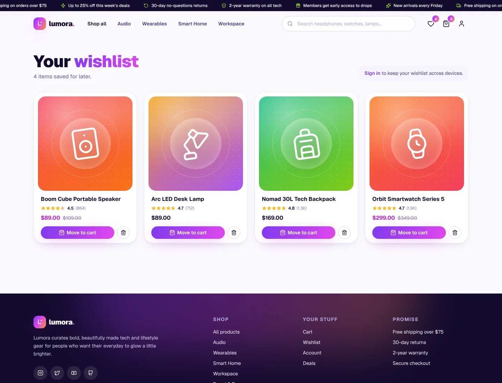
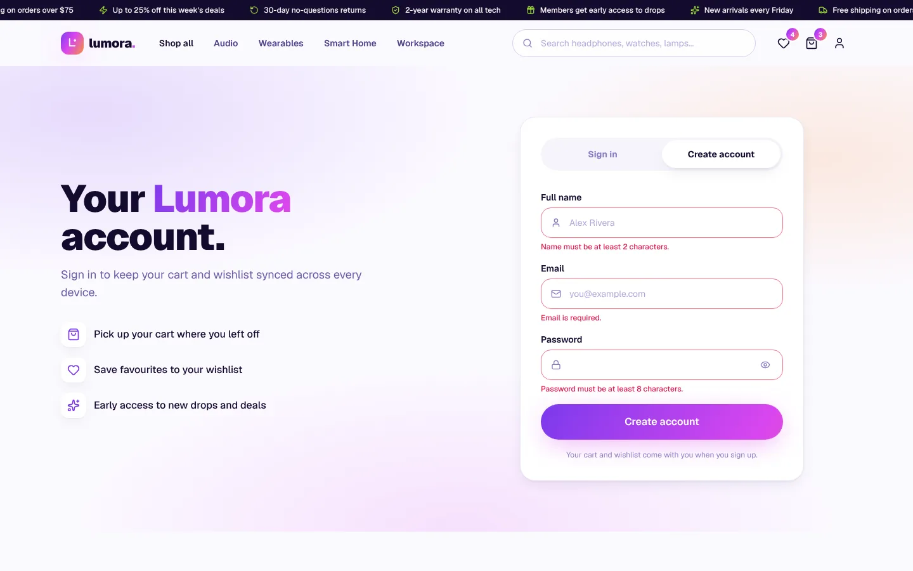
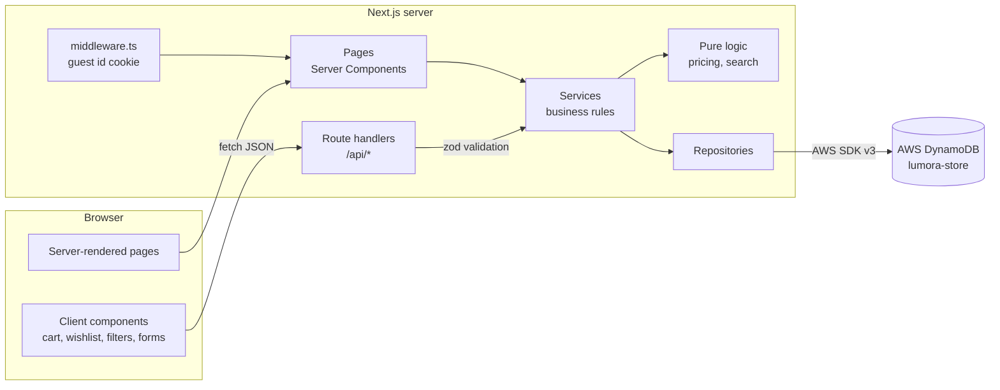

# Lumora: tech & lifestyle store

Lumora is a full-stack e-commerce store built with **Next.js 15 (App Router), React 19,
TypeScript, Tailwind CSS and AWS DynamoDB**. Shoppers can browse six collections, search
and filter 36 products, keep a cart and a wishlist (signed in or not), and create an
account. Every page is responsive and has loading, empty and error states.


## Contents

- [Features](#features)
- [Tech stack](#tech-stack)
- [Screenshots](#screenshots)
- [Project structure](#project-structure)
- [Architecture](#architecture)
- [DynamoDB setup](#dynamodb-setup)
- [Environment variables](#environment-variables)
- [Installation](#installation)
- [Available scripts](#available-scripts)
- [API reference](#api-reference)
- [Testing and quality](#testing-and-quality)
- [Deployment (Vercel)](#deployment-vercel)
- [Security](#security)
- [Known limitations and next steps](#known-limitations-and-next-steps)

## Features

**Storefront**

- Home page with an interactive parallax hero, category grid, bestsellers, flash deals with
  a live countdown, a scrolling new-arrivals rail and a newsletter sign-up.
- Six categories (Audio, Wearables, Smart Home, Workspace, Travel & Bags, Fitness), each
  with its own page.
- Product listing with **search, filters and sorting**: category, price presets or a custom
  range, minimum rating, in stock, on sale; sort by featured, newest, price, rating or name.
  Filters live in the URL, so every result page can be bookmarked and shared.
- Search-as-you-type suggestions in the header, with full keyboard support.
- Product detail page with a gallery (hover to zoom), colours, quantity, stock status,
  features, specifications and **related products**.
- Generated product art (CSS gradients and icons), so the store looks complete with no image
  hosting. Real photos can be added per product through the `images` field.

**Cart and wishlist**

- Add to cart, change quantity, remove items, clear the cart.
- Subtotal, savings, shipping (free over $75) and total, with a free-shipping progress bar.
- Stock-aware: quantities are capped by stock and a 10-per-item limit; sold-out items are
  flagged and left out of the total.
- Wishlist with add/remove and "move to cart". Duplicates are blocked by the database.
- Works for guests too: their cart and wishlist are merged into the account on sign-in.

**Accounts**

- Sign up, sign in and sign out, with secure httpOnly session cookies.
- Profile page: edit your name, see cart and wishlist counts, delete your account.
- Admin role (by email) for creating, updating and deleting products through the API.

**Experience**

- Fully responsive (mobile drawer menu, mobile filter drawer, touch-friendly controls).
- Skeleton loading states, friendly empty states, toast notifications.
- Error handling at every layer: validation messages under each field, error pages with
  retry, a custom 404 page, and consistent JSON errors from the API.
- Accessible: semantic HTML, labelled controls, focus rings, skip link, `aria-live`
  result counts, reduced-motion support.
- SEO: page titles and descriptions, `sitemap.xml`, `robots.txt` and product structured data.

## Tech stack

| Layer          | Technology |
| -------------- | ---------- |
| Framework      | Next.js 15 (App Router, Server Components, Route Handlers) |
| UI             | React 19, Tailwind CSS 3, Lucide icons, Geist font, Sonner toasts |
| Language       | TypeScript (strict mode) |
| Database       | AWS DynamoDB (single-table design) via AWS SDK v3 |
| Validation     | Zod (shared by the browser and the server) |
| Auth           | bcrypt password hashing, JWT (HS256, `jose`) in an httpOnly cookie |
| Testing        | Vitest, ESLint, `tsc` |
| Local database | Amazon DynamoDB Local (`dynamo-db-local`, needs Java 17+) or Docker |
| CI / hosting   | GitHub Actions, Vercel |

## Screenshots

| Desktop | Mobile |
| ------- | ------ |
|  |  |
|  |  |
|  |  |
|  |  |
|  |  |

More in [`docs/screenshots`](docs/screenshots): search results, a category page, the empty
cart, the 404 page and tablet layouts.

## Project structure

```
lumora/
├── .github/workflows/ci.yml   # lint, typecheck, test and build on every push
├── docs/
│   ├── DATABASE.md            # DynamoDB design, access patterns and CRUD
│   └── screenshots/
├── scripts/                   # database tooling (run with tsx)
│   ├── create-table.ts        # creates the table, GSIs and TTL
│   ├── seed.ts                # loads the catalog from src/data/catalog.ts
│   └── local-dynamodb.ts      # starts DynamoDB Local on port 8000
├── src/
│   ├── app/                   # routes (UI pages and API)
│   │   ├── api/               # REST route handlers (thin: validate → service → JSON)
│   │   ├── products/          # listing + [slug] detail page
│   │   ├── categories/[slug]/
│   │   ├── cart/  wishlist/  account/
│   │   ├── layout.tsx         # shell: header, footer, store provider
│   │   ├── not-found.tsx  error.tsx  global-error.tsx
│   │   └── sitemap.ts  robots.ts  icon.svg
│   ├── components/            # UI only, grouped by feature
│   │   ├── ui/                # buttons, inputs, badges, skeletons, empty states
│   │   ├── layout/  home/  catalog/  product/  cart/  account/  art/
│   │   └── providers/         # client store: cart count, wishlist, user
│   ├── lib/
│   │   ├── api/               # route wrapper, JSON errors, CSRF origin check, admin guard
│   │   ├── auth/              # sessions, guest ids
│   │   ├── business/          # pure logic: pricing, search, filters, related products
│   │   ├── services/          # use cases: catalog, cart, wishlist, auth, user, newsletter
│   │   ├── db/                # DynamoDB client, key design, repositories
│   │   ├── validation/        # zod schemas shared by client and server
│   │   ├── client/            # typed fetch helper for the browser
│   │   ├── utils/             # formatting, class names, slugs
│   │   ├── config.ts          # validated environment variables
│   │   └── errors.ts          # AppError hierarchy
│   ├── data/catalog.ts        # seed data: 6 categories, 36 products
│   ├── types/index.ts         # shared domain types
│   └── middleware.ts          # assigns guest ids
└── tests/                     # unit tests (pricing, catalog queries, validation)
```

## Architecture



The code is layered so each part has one job, and dependencies only point downwards:

1. **UI** (`src/app/**/page.tsx`, `src/components`). Pages are Server Components that read data
   through services directly. Interactive parts (cart, filters, forms) are Client Components
   that call the API.
2. **API** (`src/app/api`). Each handler parses input with zod, calls one service function and
   returns JSON. The `route()` wrapper turns any thrown `AppError` into a consistent error
   response and rejects cross-site write requests.
3. **Services** (`src/lib/services`). Use cases such as "add to cart" or "sign in". They apply the
   rules (stock, limits, merging guest data) and know nothing about HTTP.
4. **Business logic** (`src/lib/business`). Pure functions (totals, search scoring, filters,
   related products) with no I/O, which is why they are easy to unit test.
5. **Data access** (`src/lib/db`). Repositories are the only code that talks to DynamoDB. Keys are
   built in one place (`keys.ts`), and AWS errors are mapped to safe `503` responses.

**Caching.** The product list and categories are cached with `unstable_cache` for five minutes
and tagged `catalog`; admin writes call `revalidateTag("catalog")`. Carts, wishlists and
account pages are always rendered fresh.

**Guest shopping.** Middleware gives each new visitor an anonymous id cookie, so the cart and
wishlist work before sign-up. On sign-in, guest items are merged into the account.

## DynamoDB setup

The full design (keys, indexes, every access pattern and CRUD operation) is in
**[docs/DATABASE.md](docs/DATABASE.md)**. In short: one table, `PK`/`SK` keys, a GSI for products
by category, a GSI for all products by date, TTL on guest data, on-demand billing.

### Option A: local DynamoDB (no AWS account needed)

You need **Java 17+** (`java -version`). The `dynamo-db-local` package bundles Amazon's
official DynamoDB Local, so nothing else to install.

```bash
# terminal 1: start DynamoDB Local on http://localhost:8000 (data saved in ./.dynamodb)
npm run db:local

# terminal 2: create the table and load the catalog
npm run db:setup
```

Make sure `.env.local` contains `DYNAMODB_ENDPOINT=http://localhost:8000`.

Prefer Docker? Run `docker run -p 8000:8000 amazon/dynamodb-local` instead of `npm run db:local`.

### Option B: AWS

1. **Create an IAM user for the app** in the AWS console (IAM → Users → Create user). Attach an
   inline policy that allows only the actions the app uses on this table. The exact policy is in
   [docs/DATABASE.md](docs/DATABASE.md#security-and-operations). Create an access key for it
   (Security credentials → Create access key → "Application running outside AWS").
2. **Put the values in `.env.local`**: `LUMORA_AWS_REGION`, `LUMORA_AWS_ACCESS_KEY_ID`,
   `LUMORA_AWS_SECRET_ACCESS_KEY`, `DYNAMODB_TABLE`, and leave `DYNAMODB_ENDPOINT` empty.
3. **Create and seed the table** once. Creating a table needs more rights than the app has, so run
   this with an admin AWS profile (or temporarily add `dynamodb:CreateTable` and
   `dynamodb:UpdateTimeToLive` to the policy):

   ```bash
   npm run db:setup
   ```

   This creates `lumora-store` with both indexes, enables TTL on `expiresAt` and loads 6 categories
   and 36 products. It is safe to run again: an existing table is reused and products are updated.
4. **Recommended:** turn on point-in-time recovery for the table (Backups tab in the console).

## Environment variables

Copy `.env.example` to `.env.local` and fill it in. Nothing secret is committed; `.env.local`
is git-ignored.

| Variable | Required | Description |
| -------- | -------- | ----------- |
| `LUMORA_AWS_REGION` | yes | AWS region of the table, e.g. `ap-south-1` |
| `LUMORA_AWS_ACCESS_KEY_ID` | on Vercel / outside AWS | Access key of the app's IAM user |
| `LUMORA_AWS_SECRET_ACCESS_KEY` | on Vercel / outside AWS | Secret of that access key |
| `DYNAMODB_TABLE` | no (default `lumora-store`) | Table name |
| `DYNAMODB_ENDPOINT` | local only | `http://localhost:8000` for DynamoDB Local; leave empty for AWS |
| `AUTH_SECRET` | yes in production | At least 32 characters, used to sign session cookies. Generate one with `node -e "console.log(require('crypto').randomBytes(32).toString('base64'))"` |
| `ADMIN_EMAILS` | no | Comma-separated emails that get the admin role when they sign up |
| `NEXT_PUBLIC_SITE_URL` | recommended | Public URL of the site, used for metadata and the sitemap |

The AWS variables use a `LUMORA_` prefix because Vercel reserves the standard `AWS_*` names.
If both key variables are empty, the SDK falls back to the default credential chain (for
example an IAM role when hosted on AWS).

## Installation

Requirements: **Node.js 20.9+** (22 recommended, see `.nvmrc`), npm, and either Java 17+ or
Docker for the local database (or an AWS account).

```bash
git clone https://github.com/<your-username>/lumora.git
cd lumora
npm install
cp .env.example .env.local      # then edit the values (see above)

npm run db:local                # terminal 1 (skip if you use AWS)
npm run db:setup                # terminal 2: create table + seed
npm run dev                     # http://localhost:3000
```

To try the admin API, add your email to `ADMIN_EMAILS` before you sign up.

## Available scripts

| Script | What it does |
| ------ | ------------ |
| `npm run dev` | Start the development server |
| `npm run build` / `npm start` | Production build / serve it |
| `npm run lint` | ESLint (Next.js core web vitals + TypeScript rules) |
| `npm run typecheck` | TypeScript in strict mode, no emit |
| `npm test` | Unit tests with Vitest |
| `npm run db:local` | Start DynamoDB Local on port 8000 |
| `npm run db:create` | Create the table, indexes and TTL |
| `npm run db:seed` | Load the catalog |
| `npm run db:setup` | `db:create` then `db:seed` |

## API reference

All endpoints return JSON. Errors always look like
`{ "error": { "code": "OUT_OF_STOCK", "message": "...", "details": { "fieldErrors": { ... } } } }`.
Write requests must come from the site's own origin.

| Method | Path | Description |
| ------ | ---- | ----------- |
| GET | `/api/health` | Database connectivity check (`200` or `503`) |
| GET | `/api/categories` | Categories with product counts |
| GET | `/api/products` | Search and filter: `q`, `category`, `minPrice`, `maxPrice` (dollars), `minRating`, `inStock`, `onSale`, `sort`, `page`, `pageSize` |
| POST | `/api/products` | Create a product (admin) |
| GET | `/api/products/:slug` | Product and related products |
| PATCH / DELETE | `/api/products/:slug` | Update / delete a product (admin) |
| GET | `/api/search?q=` | Search suggestions for the header |
| GET / POST / DELETE | `/api/cart` | Read the cart / add `{ productSlug, quantity }` / clear it |
| PATCH / DELETE | `/api/cart/:slug` | Set quantity `{ quantity }` (0 removes) / remove a line |
| GET / POST | `/api/wishlist` | Read / add `{ productSlug }` (409 if already saved) |
| DELETE | `/api/wishlist/:slug` | Remove from the wishlist |
| POST | `/api/auth/signup` | `{ name, email, password }` |
| POST | `/api/auth/signin` | `{ email, password }` |
| POST | `/api/auth/signout` | End the session |
| GET | `/api/auth/me` | Current user or `null` |
| PATCH / DELETE | `/api/account` | Update `{ name }` / delete the account |
| POST | `/api/newsletter` | `{ email }` |

Example:

```bash
curl "http://localhost:3000/api/products?category=audio&maxPrice=150&sort=price-asc"
```

## Testing and quality

```bash
npm run lint && npm run typecheck && npm test && npm run build
```

- **Unit tests** (`tests/`) cover cart totals, shipping and discounts, quantity limits and guest
  merges, search ranking, every filter and sort, pagination, related products and the
  validation schemas.
- **CI** runs the same four checks on every push and pull request
  (`.github/workflows/ci.yml`).
- The full flow (browse, filter, search, cart, wishlist, sign-up with guest merge, sign-out,
  admin product CRUD, error cases) was checked end to end against DynamoDB Local.

## Deployment (Vercel)

1. Push the repository to GitHub.
2. In Vercel, choose **Add New → Project** and import the repository. The framework is detected
   automatically.
3. Under **Environment Variables**, add `LUMORA_AWS_REGION`, `LUMORA_AWS_ACCESS_KEY_ID`,
   `LUMORA_AWS_SECRET_ACCESS_KEY`, `DYNAMODB_TABLE`, `AUTH_SECRET`, `ADMIN_EMAILS` (optional) and
   `NEXT_PUBLIC_SITE_URL` (your Vercel URL). Do **not** set `DYNAMODB_ENDPOINT`.
4. Deploy. Then open `https://<your-app>/api/health`; it should return `{"status":"ok"}`.

`vercel.json` runs the server functions in Mumbai (`bom1`), next to a table in `ap-south-1`.
If your table is in another region, change it to the closest
[Vercel region](https://vercel.com/docs/edge-network/regions).

The app also runs anywhere Node.js does (`npm run build && npm start`), for example on AWS
App Runner or an EC2 instance with an IAM role, in which case the access key variables can be
left empty.

## Security

- No credentials in the code; configuration is validated at startup (`src/lib/config.ts`).
- Passwords hashed with bcrypt; sign-in takes the same time whether or not the email exists.
- Sessions are signed JWTs in `httpOnly`, `SameSite=Lax`, `Secure` (in production) cookies.
- Write requests from other origins are rejected (CSRF protection).
- Every input is validated with zod; request bodies are limited to 64 KB.
- Security headers: `X-Content-Type-Options`, `X-Frame-Options`, `Referrer-Policy`,
  `Permissions-Policy`.
- The app's IAM user can only read and write items in its own table.
- Internal errors are logged on the server and never sent to the browser.

## Known limitations and next steps

- **Checkout is a placeholder.** Payments (for example Stripe Checkout) and an `ORDER#` entity
  are the natural next step.
- **Search runs in memory** on the cached catalog, which is right for hundreds of products. For a
  large catalog, sync the table to Amazon OpenSearch (see [docs/DATABASE.md](docs/DATABASE.md#search-and-scaling)).
- **Product management** is API-only for admins; an admin dashboard UI could be added on top.
- **Rate limiting** for sign-in and sign-up should be added at the edge (for example Vercel
  Firewall rules or AWS WAF) before a public launch.
- `npm audit` reports an advisory in the PostCSS copy bundled inside Next.js 15. It only affects
  build-time processing of the project's own CSS, not the running site; it is resolved by
  upgrading to Next.js 16.

## License

MIT
