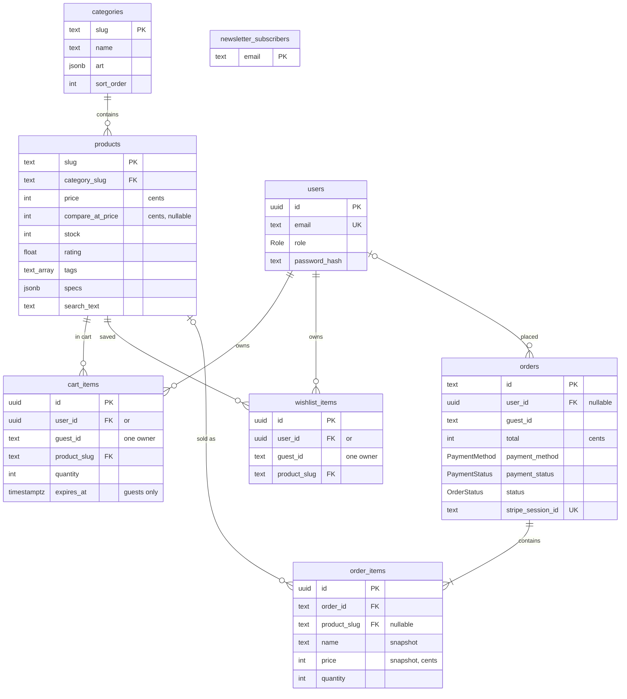

# Database design (PostgreSQL + Prisma)

goCart stores everything in **PostgreSQL**, accessed through **Prisma ORM 7** with the
`pg` driver adapter. In production the database is hosted on **Neon** (serverless
Postgres); locally any PostgreSQL 14+ works.

- [Schema at a glance](#schema-at-a-glance)
- [Tables](#tables)
- [Indexes and constraints](#indexes-and-constraints)
- [How each feature uses the database](#how-each-feature-uses-the-database)
- [CRUD operations by entity](#crud-operations-by-entity)
- [Transactions and data integrity](#transactions-and-data-integrity)
- [Search](#search)
- [Guest data and cleanup](#guest-data-and-cleanup)
- [Migrations and seeding](#migrations-and-seeding)
- [Neon setup](#neon-setup)
- [Performance and scaling](#performance-and-scaling)

The schema lives in [`prisma/schema.prisma`](../prisma/schema.prisma) and the SQL that
creates it in [`prisma/migrations`](../prisma/migrations).

## Schema at a glance



Design choices:

- **Normalised relational model.** Each concept has its own table, linked by foreign
  keys, so the database itself prevents orphaned cart lines or orders for unknown products.
- **Natural keys for the catalog.** Categories and products use their URL slug as the primary
  key, so product URLs, cart lines and order lines all use the same identifier.
- **Money as integer cents** (`INTEGER`), never floating point.
- **One owner per cart/wishlist row.** A row belongs to a signed-in user (`user_id`) *or* an
  anonymous guest (`guest_id`); a CHECK constraint enforces exactly one.
- **Order lines are snapshots.** `order_items` copies the product name and price at purchase
  time, so later price changes or deletions never change past orders.
- **snake_case in SQL, camelCase in TypeScript**, mapped with `@map` / `@@map`.

## Tables

| Table | Purpose | Key columns |
| ----- | ------- | ----------- |
| `users` | Customer and admin accounts | `id` (UUID), `email` (unique), `role` (`customer`/`admin`), `password_hash` (bcrypt) |
| `categories` | The six store collections | `slug` (PK), `name`, `tagline`, `description`, `art` (JSONB), `sort_order` |
| `products` | The catalog | `slug` (PK), `category_slug` (FK), `price`, `compare_at_price`, `stock`, `rating`, `review_count`, `featured`, `tags[]`, `features[]`, `specs` (JSONB), `colors` (JSONB), `art` (JSONB), `images[]`, `search_text` |
| `cart_items` | One row per product in a cart | `user_id` or `guest_id`, `product_slug` (FK), `quantity`, `expires_at` |
| `wishlist_items` | One row per saved product | `user_id` or `guest_id`, `product_slug` (FK), `expires_at` |
| `orders` | Placed orders | `id` (`ord_…`), `user_id`/`guest_id`, customer and shipping fields, `subtotal`/`shipping`/`savings`/`total`, `payment_method`, `payment_status`, `status`, `stripe_session_id` |
| `order_items` | Lines of an order | `order_id` (FK), `product_slug` (FK, nullable), `name`, `price`, `quantity`, `line_total`, `art` |
| `newsletter_subscribers` | Newsletter sign-ups | `email` (PK) |

Enums: `Role` (`customer`, `admin`), `PaymentMethod` (`stripe`, `cod`), `PaymentStatus`
(`pending_payment`, `pending_cod`, `paid`, `failed`), `OrderStatus` (`confirmed`,
`processing`, `shipped`, `delivered`, `cancelled`).

Every table has `created_at`; mutable tables also have `updated_at`, maintained by Prisma.

## Indexes and constraints

| Object | Kind | Why |
| ------ | ---- | --- |
| `users_email_key` | UNIQUE | One account per email, even with simultaneous sign-ups |
| `products_category_slug_idx` | INDEX | Category pages and filters |
| `products_created_at_idx` (DESC) | INDEX | "Newest" sort and new arrivals |
| `products_featured_rating_idx` | INDEX | Default "Featured" sort and the bestsellers section |
| `products_price_idx` | INDEX | Price filters and price sorting |
| `cart_items_user_id_product_slug_key`, `cart_items_guest_id_product_slug_key` | UNIQUE | One line per product per cart; makes "add to cart" a single UPSERT |
| `wishlist_items_*_product_slug_key` | UNIQUE | A product can't be saved twice |
| `cart_items_expires_at_idx`, `wishlist_items_expires_at_idx` | INDEX | Fast cleanup of expired guest data |
| `orders_user_id_created_at_idx`, `orders_guest_id_created_at_idx` | INDEX | Order history, newest first |
| `orders_stripe_session_id_key` | UNIQUE | One order per Stripe Checkout session |
| `products_price_check`, `products_stock_check`, `products_rating_check`, `products_review_count_check` | CHECK | No negative prices or stock; rating 0–5 |
| `products_compare_at_price_check` | CHECK | A sale price must be lower than the original price |
| `cart_items_quantity_check`, `order_items_quantity_check` | CHECK | Quantities are always positive |
| `cart_items_one_owner_check`, `wishlist_items_one_owner_check` | CHECK | Exactly one of `user_id` / `guest_id` is set |
| `orders_amounts_check`, `order_items_price_check` | CHECK | Order amounts are never negative |

Foreign-key behaviour:

| Relationship | ON DELETE | Effect |
| ------------ | --------- | ------ |
| `products.category_slug → categories` | RESTRICT | A category with products can't be deleted |
| `cart_items / wishlist_items → users` | CASCADE | Deleting an account deletes its cart and wishlist |
| `cart_items / wishlist_items → products` | CASCADE | Deleting a product removes it from every cart and wishlist |
| `orders.user_id → users` | SET NULL | Orders are kept for the shop's records after an account is deleted |
| `order_items.product_slug → products` | SET NULL | Past orders keep their snapshot when a product is deleted |
| `order_items.order_id → orders` | CASCADE | Order lines belong to their order |

All product foreign keys use `ON UPDATE CASCADE`, so renaming a slug would update every reference.

## How each feature uses the database

| Feature | Query | Code |
| ------- | ----- | ---- |
| Category list | `SELECT … FROM categories ORDER BY sort_order` | `categoryRepository.list` |
| Product counts per category | `SELECT category_slug, COUNT(*) … GROUP BY category_slug` | `productRepository.countByCategory` |
| Listing, filters, sort, pagination | `SELECT … WHERE <filters> ORDER BY <sort>, slug LIMIT n OFFSET m` + `COUNT(*)` | `catalogService.searchProducts`, `buildProductWhere` |
| Text search (ranked) | `WHERE search_text LIKE '%word%' AND …`, then ranked by relevance in code | `catalogService.searchProducts` |
| Product page | `SELECT … WHERE slug = $1` | `productRepository.getBySlug` |
| Related products | same category OR overlapping tags (`tags && $1`), ranked in code | `catalogService.getRelatedProducts` |
| Bestsellers / deals / new arrivals | `WHERE featured` / `WHERE compare_at_price IS NOT NULL AND stock > 0` / `ORDER BY created_at DESC` | `catalogService` |
| Cart | `SELECT … FROM cart_items WHERE user_id = $1` + products by slug (`IN`) | `cartRepository.list`, `productRepository.getManyBySlugs` |
| Add to cart / change quantity | `INSERT … ON CONFLICT (user_id, product_slug) DO UPDATE` (Prisma `upsert`) | `cartRepository.setQuantity` |
| Wishlist add | `INSERT`, unique violation → "already in wishlist" | `wishlistRepository.add` |
| Sign-in | `SELECT … FROM users WHERE email = $1` | `userRepository.getByEmail` |
| Place order | Transaction (see below) | `orderRepository.create` |
| Order history | `SELECT … FROM orders WHERE user_id = $1 ORDER BY created_at DESC` | `orderRepository.listByOwner` |
| Health check | `SELECT 1` | `GET /api/health` |

Read-heavy catalog queries are cached by Next.js for five minutes and tagged `catalog`;
every admin write calls `revalidateTag("catalog")`, so changes appear immediately. Carts,
wishlists, accounts and orders are never cached.

## CRUD operations by entity

All database access is in [`src/lib/db/repositories`](../src/lib/db/repositories).
Services in `src/lib/services` apply the business rules, and API routes expose them.

### Products

| Action | SQL (via Prisma) | API |
| ------ | ---------------- | --- |
| Create | `INSERT INTO products …` (duplicate slug → 409 `PRODUCT_EXISTS`) | `POST /api/products` (admin) |
| Read | `SELECT` by slug, filtered lists, counts | `GET /api/products`, `GET /api/products/:slug` |
| Update | `UPDATE products SET … WHERE slug = $1` (missing → 404); `search_text` is rebuilt | `PATCH /api/products/:slug` (admin) |
| Delete | `DELETE FROM products WHERE slug = $1` (cascades to carts and wishlists) | `DELETE /api/products/:slug` (admin) |

### Categories

| Action | SQL | Where |
| ------ | --- | ----- |
| Create / update | `INSERT … ON CONFLICT (slug) DO UPDATE` | `categoryRepository.upsert`, seed script |
| Read | `SELECT … ORDER BY sort_order` | `GET /api/categories`, category pages |
| Delete | `DELETE` (blocked while products exist) | `categoryRepository.delete` |

### Users

| Action | SQL | API |
| ------ | --- | --- |
| Create | `INSERT INTO users …` (duplicate email → 409 `EMAIL_TAKEN`) | `POST /api/auth/signup` |
| Read | `SELECT … WHERE email = $1` / `WHERE id = $1` | `POST /api/auth/signin`, `GET /api/auth/me` |
| Update | `UPDATE users SET name = $1 WHERE id = $2` | `PATCH /api/account` |
| Delete | `DELETE FROM users WHERE id = $1` (cascades cart and wishlist; orders keep `user_id = NULL`) | `DELETE /api/account` |

### Cart items

| Action | SQL | API |
| ------ | --- | --- |
| Add / update quantity | `INSERT … ON CONFLICT DO UPDATE SET quantity = $n` | `POST /api/cart`, `PATCH /api/cart/:slug` |
| Read | `SELECT` lines + live product data | `GET /api/cart` |
| Remove line | `DELETE … WHERE owner AND product_slug = $1` | `DELETE /api/cart/:slug` |
| Clear | `DELETE … WHERE owner` | `DELETE /api/cart` |

Cart rows store only the product and quantity; prices and stock are always read live from
`products`, so customers never see a stale price.

### Wishlist items

| Action | SQL | API |
| ------ | --- | --- |
| Add | `INSERT` (unique violation → 409 `ALREADY_IN_WISHLIST`) | `POST /api/wishlist` |
| Read | `SELECT` + products | `GET /api/wishlist` |
| Remove | `DELETE … WHERE owner AND product_slug = $1` | `DELETE /api/wishlist/:slug` |

### Orders

| Action | SQL | API |
| ------ | --- | --- |
| Create | Transaction: reserve stock, insert order + lines, empty cart | `POST /api/checkout` |
| Read | `SELECT … JOIN order_items` (only the buyer or an admin) | `GET /api/orders/:id`, success page, account page |
| Update | `UPDATE orders SET payment_status = 'paid'` / `status = 'cancelled'` | Stripe webhook, `POST /api/checkout/verify` |

### Newsletter

`INSERT INTO newsletter_subscribers (email)`; a repeat sign-up hits the primary key and is
reported as "already subscribed" (`POST /api/newsletter`).

## Transactions and data integrity

**Placing an order** (`orderRepository.create`) runs in one transaction:

```sql
BEGIN;
  -- for each line: reserve stock only if enough is left
  UPDATE products SET stock = stock - $qty WHERE slug = $slug AND stock >= $qty;  -- 0 rows → OUT_OF_STOCK, ROLLBACK
  INSERT INTO orders (…) VALUES (…);
  INSERT INTO order_items (…) VALUES (…), (…);
  DELETE FROM cart_items WHERE user_id = $owner;   -- cash on delivery only
COMMIT;
```

The conditional `UPDATE … WHERE stock >= $qty` is atomic in PostgreSQL, so two shoppers
checking out the last unit at the same moment can't both succeed. This is covered by an
integration test that races three checkouts for one unit.

**Card payments (Stripe)** reserve stock when the order is created. The order is marked paid
only after the server confirms it with Stripe (signed webhook or a direct API check). If the
checkout session expires, or the buyer cancels, `orderRepository.cancelUnpaid` puts the stock
back in another transaction, at most once.

**Other guarantees**

- Unique email, one cart line per product, no duplicate wishlist entries: unique indexes.
- Prices, stock, quantities and order amounts can't go negative: CHECK constraints.
- Every request body is validated with zod before it reaches the database.
- Database errors are logged on the server and returned as a generic `503`
  (`withDb()` in `src/lib/db/errors.ts`); connection details never reach the browser.

## Search

Each product has a `search_text` column: its name, tagline, tags, category and description,
lower-cased with accents and punctuation removed (`buildSearchText()`). It is rebuilt on
every create and update.

- **Filtering happens in PostgreSQL.** Every word typed must appear in `search_text`
  (`search_text LIKE '%word%'`), combined with the other filters.
- **Ranking happens in code.** With the default sort, matches are ordered by relevance
  (name matches beat tag matches, which beat description matches). SQL `ORDER BY` can't
  express this, so `queryProducts()` ranks the matching rows.

For a much larger catalog, add a trigram index (`CREATE EXTENSION pg_trgm;
CREATE INDEX … USING gin (search_text gin_trgm_ops)`) or switch to PostgreSQL full-text
search (`tsvector` + `ts_rank`); the rest of the app wouldn't change.

## Guest data and cleanup

Shoppers can use the cart and wishlist before signing up. Middleware gives each visitor an
anonymous `gocart_gid` cookie, and their rows are stored with `guest_id = 'guest-<uuid>'`
and `expires_at` 30 days ahead (pushed back on every change).

On sign-in or sign-up, the guest cart is merged into the account (quantities added together,
up to the limit), the wishlist is merged, and guest orders are moved to the account.

A daily Vercel Cron job calls `GET /api/cron/cleanup` (protected by `CRON_SECRET`), which
deletes guest rows whose `expires_at` has passed.

## Migrations and seeding

| Command | What it does |
| ------- | ------------ |
| `npm run db:migrate` | Development: create a new migration from `schema.prisma` changes and apply it |
| `npm run db:deploy` | Apply pending migrations (`prisma migrate deploy`); used in production |
| `npm run db:seed` | Load the 6 categories and 36 products (`prisma/seed.ts`, safe to re-run) |
| `npm run db:setup` | `db:deploy` + `db:seed`, for a fresh database |
| `npm run db:reset` | Drop everything and re-apply all migrations (development only) |
| `npm run db:studio` | Browse and edit data in Prisma Studio |

On Vercel, `vercel.json` runs `npm run vercel-build` = `prisma migrate deploy && next build`,
so every deployment applies new migrations before the new code goes live.

CI applies the migrations to a fresh PostgreSQL 16 service, checks that they match
`schema.prisma` (`prisma migrate diff --exit-code`), seeds, and runs the integration tests.

## Neon setup

1. Sign up at [neon.tech](https://neon.tech) (free plan, no card needed) and create a project.
   Pick the region closest to your users and to your Vercel functions (`vercel.json` uses
   Singapore, `sin1`, so choose **AWS Asia Pacific (Singapore)**).
2. On the project dashboard, click **Connect**. Copy two connection strings:
   - **Pooled** (host contains `-pooler`) → `DATABASE_URL`. The app uses this; the pooler lets
     many serverless functions share a small number of database connections.
   - **Direct** (turn "Connection pooling" off) → `DIRECT_URL`. Migrations use this.
3. Put both in `.env.local`, then run `npm run db:setup`.

## Performance and scaling

- Serverless-friendly connections: the pooled Neon URL plus a small per-function pool
  (`max: 5` in production).
- Every list query is index-backed and paginated with `LIMIT/OFFSET` plus a stable tie-breaker.
- Cart and wishlist reads are two indexed queries regardless of size.
- Catalog reads are cached for five minutes and invalidated on admin writes.
- Next steps at larger scale: keyset pagination for deep pages, a trigram or full-text index for
  search, and Neon read replicas for read-heavy traffic.
